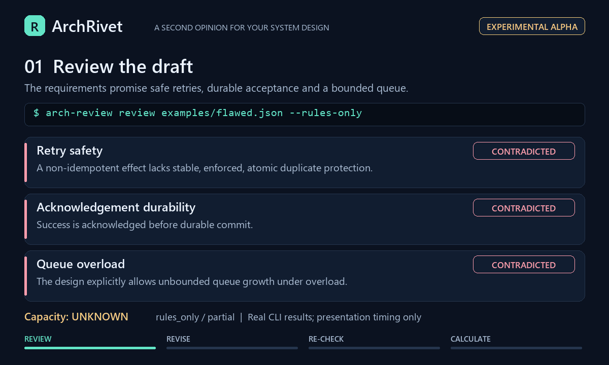

<div align="center">

# ArchRivet

### A second opinion for your system design.

**Review backend decisions, spot missing details, and plan workload before you build.**

[](https://github.com/Ujjansh05/archrivet/actions/workflows/ci.yml) [](#what-is-proven-today) [](#try-it-locally) [](LICENSE)

[Watch the demo](#see-it-in-action) · [Get started](#try-it-locally) · [Download](https://github.com/Ujjansh05/archrivet/releases) · [Report an issue](https://github.com/Ujjansh05/archrivet/issues)

</div>

ArchRivet is a local MCP plugin for reviewing backend architectures with your AI assistant. Your assistant drafts and explains the design; ArchRivet returns focused findings, supporting references, workload estimates, and questions that still need answers.

## Where it helps

- **Review potential risks early.** Eight checks cover retries, acknowledgements, queues, transactions, replica reads, caching, failover, and dependency deadlines.
- **Understand each finding.** See reasons, source references, missing facts, and suggested verification steps.
- **Plan for your workload.** Estimate traffic, message fan-out, and storage growth from explicit assumptions.
- **Keep your existing workflow.** Connect through MCP or run reviews from the command line.
- **Start with your current hardware.** The rules-based review needs no model download or GPU. Optional model inference supports CPU and CUDA.

Useful for messaging services, notification systems, transactional backends, and system-design exercises. Supply structured requirements and design facts using the [example and input guide](docs/backend-v2.md).

## See it in action



*Demo of the three-check rules-based workflow; no model inference. [Text walkthrough](docs/assets/README.md) · [Static preview](docs/assets/archrivet-demo.png)*

**What if the design is incomplete?** [Run the clarification example](docs/clarification-walkthrough.md) to see an unresolved retry check, the missing facts, and how answers change the verdict.

## Try it locally

You need **Git and Python 3.11 or 3.12**. Start with the included example; installation downloads Python dependencies. The package is available on [GitHub Releases](https://github.com/Ujjansh05/archrivet/releases), not PyPI.

```bash
git clone https://github.com/Ujjansh05/archrivet.git
cd archrivet
```

<details open>
<summary><strong>Windows · PowerShell</strong></summary>

```powershell
python -m venv .venv
.\.venv\Scripts\python.exe -m pip install -e .
.\.venv\Scripts\python.exe -m arch_review review examples\flawed.json --rules-only
```

</details>

<details>
<summary><strong>Linux</strong></summary>

```bash
python3 -m venv .venv
source .venv/bin/activate
python -m pip install -e .
arch-review review examples/flawed.json --rules-only
```

</details>

The review returns JSON with findings, evidence, workload estimates, and missing information. Compare it with [the revised example](examples/complete.json), or follow the [eight-check quick start](docs/backend-v2.md#install-and-run-one-review).

<a id="local-service"></a>

## Connect your AI

Follow the [MCP setup guide](docs/backend-v2.md#shared-jobs-cli-and-mcp) to start the local service and generate your host configuration. Windows users must start the service in an independent terminal before connecting. Stop an existing service before changing its configuration.

Once connected, ask your assistant:

> Review this backend design with ArchRivet using only supplied facts. Show findings and missing information, ask focused follow-up questions, and keep unanswered facts unknown. After I answer, rerun the review and explain what changed, including remaining gaps and verification steps.

An MCP-compatible host is required. Integration has been tested with Codex; other hosts need verification. Local reviews run offline after setup; your AI host follows its own provider and data-handling settings.

## Optional model download

The [complete experimental model](https://github.com/Ujjansh05/archrivet/releases/tag/model-v0.1.0) includes merged weights, tokenizer, configuration, and calibration. No separate base-model or adapter download is needed.

**[Installation instructions →](docs/merged-model.md)**

The archive is approximately **964 MB**; allow additional space for extraction and dependencies. Rules remain the default, and model inference is optional.

## What is proven today

**Experimental alpha.** Reviews cover eight defined decisions and depend on supplied facts. Workload estimates describe demand; production capacity requires relevant benchmarks and tests. Model confidence is separate from production failure risk.

The published model scored **25/36 on synthetic development cases and 4/12 on separate regression cases**. These small evaluations do not establish general architecture accuracy. [Results and limitations](docs/model-improvement-status.md)

## Feedback

[Open an issue](https://github.com/Ujjansh05/archrivet/issues) with a small example, what you expected, and what happened. Installation problems and incorrect findings are especially useful. See [CONTRIBUTING.md](CONTRIBUTING.md) to contribute. ALSO pls do 🌟 if you find interesting 

## License and acknowledgements

Original code uses the [MIT License](LICENSE). Model weights and reference materials retain their respective licenses and attribution; see [third-party notices](THIRD_PARTY_NOTICES.md).

Built with [Laya](https://nandhakishorm.github.io/laya/reference/agent/) and [MCP](https://modelcontextprotocol.io/docs/develop/build-server).
