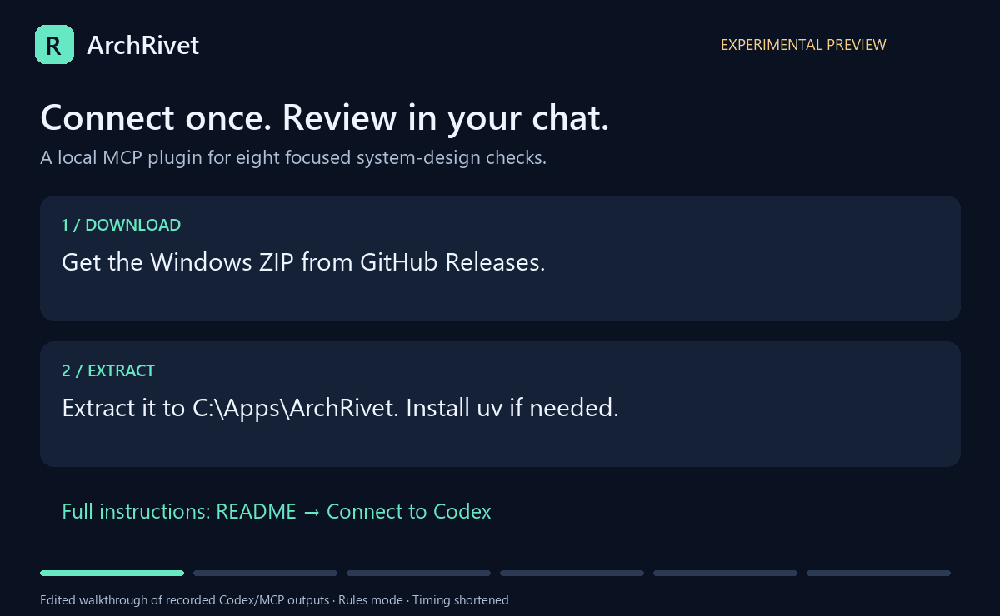
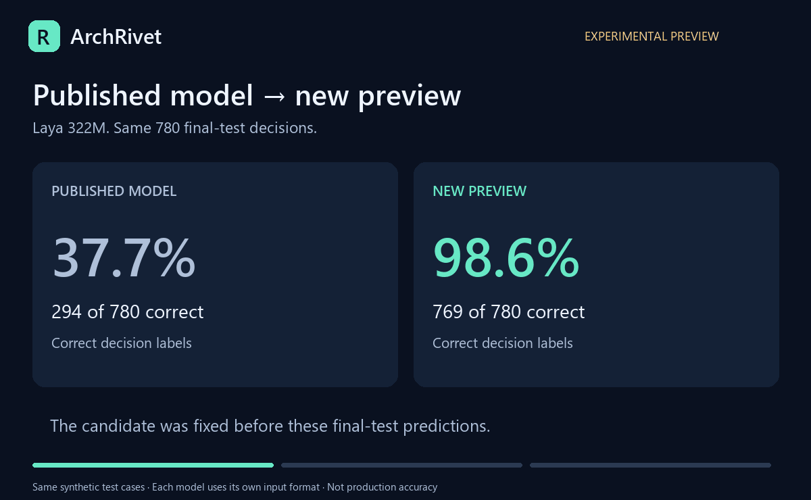

# ArchRivet

### Turn a system-design answer into a review you can follow.

Your AI explains the design. ArchRivet checks the stated facts, names the gaps, and shows what changes after your answer.

**[Download the preview](https://github.com/Ujjansh05/archrivet/releases/tag/v0.3.0a1) · [Connect to Codex](docs/quick-start-preview.md) · [See the benchmark](docs/benchmarks/2026-10-preview.md)**

## A small question that changes the answer

> “Prices must be less than five seconds old. We serve cached prices during an outage.”

ArchRivet asks: **“During an outage, how old may a cached value become?”**

If the answer is 60 seconds, the review can point to the exact requirement being broken. If you do not know, it keeps the finding unresolved.

*Edited walkthrough of actual Codex and MCP results, using rules mode. Timing is shortened. [Read the full example and answers](docs/demo-comparison.md).*

## What you get

- **Specific questions:** find the missing design detail instead of guessing.
- **Before/after reviews:** see which supplied fact changed a finding and what remains unresolved.
- **Eight focused checks:** retries, durability, queues, transactions, replica reads, caching, failover, and dependency deadlines.
- **Evidence and arithmetic:** references, workload assumptions, and calculations the assistant can explain.
- **Local checks:** rules work without a model or GPU. Optional Laya 322M runs locally on CPU; the Python runtime also supports CUDA.

Useful for product backends, payment flows, caches, notifications, and system-design discussions. Your assistant turns your description into structured facts; the plugin does not independently verify your implementation.

## Try it

1. **Download** the Windows bundle from [Releases](https://github.com/Ujjansh05/archrivet/releases/tag/v0.3.0a1).
2. **Connect** it to Codex, or install the `.mcpb` in a desktop host supporting MCPB 0.4 with UV. [Full setup guide](docs/quick-start-preview.md)
3. **Ask:** “Review my design with ArchRivet. Use only stated facts. Name what is missing, then compare the review after I answer.”

Desktop hosts with the required extension runtime manage dependency installation. Codex has a one-time setup command. Windows x64 is the tested bundle platform; a real Claude Desktop GUI test is still pending. The plugin is a direct download, not an approved directory listing. Initial setup needs internet and disk space for dependencies.

## Has the model improved?

The [benchmark](docs/benchmarks/2026-10-preview.md) compares the published model and the new preview on the same synthetic cases, including incorrect approvals and remaining failures. Each version uses its own deployment input format. This tests the model **and** formatting changes together.

The model remains **optional and experimental**. Strict accuracy gates are not met, and the tests do not establish accuracy on every real-world design. Full merged weights are included as a separate release download. Training files and scraped source collections are not part of the runtime package.

## Know what the answer means

“Supported” means the supplied facts satisfy a listed check. It does not certify the whole system. Unknown facts, rule/model disagreements, and source limitations stay visible. Workload calculations estimate demand; production capacity needs a matching load test. Model confidence is not production failure risk.

ArchRivet runs checks locally. Your AI assistant still follows its own provider and conversation-storage settings.

[Report a problem](https://github.com/Ujjansh05/archrivet/issues) with a small example and the result you expected. Original code: [MIT](LICENSE). Models and references retain their [licenses and attribution](THIRD_PARTY_NOTICES.md).
