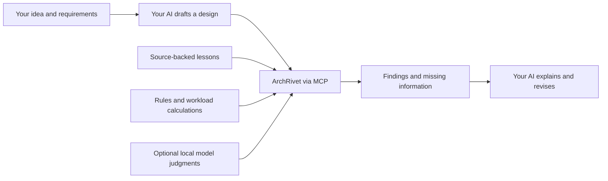

<div align="center">

# ArchRivet

### A second opinion for your system design.

Your AI drafts the architecture. **ArchRivet checks backend risks, brings evidence, and does the workload math.**

[](https://github.com/Ujjansh05/archrivet/actions/workflows/ci.yml) [](#what-is-proven-today) [](#try-it-locally) [](LICENSE)

[Watch the demo](#see-it-in-action) · [Try it locally](#try-it-locally) · [Connect your AI](#connect-your-ai) · [Results & limits](#what-is-proven-today)

</div>

> [!NOTE]
> **Experimental alpha — 0.2.0a2.** The backend interface reviews eight specific decisions with rules, Laya or an optional local generative backend. The original three-check messaging interface remains available. Findings depend on supplied facts; they do not certify a deployment or establish production capacity.

**Want the trained model?** [Download the complete 322M experimental checkpoint](docs/merged-model.md). Base weights, merged adapters, tokenizer and calibration are included. Install with `arch-review download-model --variant archrivet-experimental --destination models/archrivet-322m`. Measured accuracy remains **25/36 synthetic development cases and 4/12 separate regression cases**; rules are still the default.

**New:** transactions, replica reads, cache freshness, failover fencing and dependency retry budgets join the three messaging checks. Submit structured facts now, or explore the optional document-extraction adapter. [Eight-check quick start and example](docs/backend-v2.md) · [Model improvement status](docs/model-improvement-status.md)

## See it in action

**One flawed design. Three concrete findings. A revision you can check again.**


*Animated summary of actual v1 CLI results, with shortened wording and presentation timing. This is the three-check rules-only path: no model download required. [Static preview](docs/assets/archrivet-demo.png) · [Text walkthrough and reproduction](docs/assets/README.md)*

Suppose your requirements say retries must not repeat business writes, acknowledged messages must survive process and host failures, and the queue must stay bounded. Your first draft has message IDs, early acknowledgements and an unbounded queue:

| Decision | What ArchRivet finds | Change to review next |
|---|---|---|
| **Retry safety** | `contradicted` — IDs exist, but duplicate protection is not enforced atomically with the write. | Enforce duplicate protection with the business effect and cover the full retry window. |
| **Acknowledgement durability** | `contradicted` — success is returned before durable commit. | Acknowledge after a commit that covers the required failures. |
| **Queue overload** | `contradicted` — sustained overload can grow the queue without a bound. | Bound the queue and reject excess work before accepting it, with a retry policy. |

The [revised example](examples/complete.json) supplies those mechanisms, so all three rule verdicts become `supported`. The review still asks for failure and load tests. It returns **capacity unknown** because neither example supplies a matching benchmark.

For the same example workload, the code calculates **500 peak messages/second**, **1,500 peak deliveries/second** and **0.956 TB retained storage**. Those estimates use 100 average messages/second, a 5× peak, three recipients, 1,024-byte messages, 30-day retention, one stored copy, replication factor three and 20% storage overhead. They describe demand, not measured server capacity.

## Where it helps

| You are working on… | Use ArchRivet to… |
|---|---|
| A chat, notification or messaging backend | Check retry, acknowledgement and queue policies before implementation. |
| A transactional backend with replicas and caches | Check declared atomicity, read guarantees, freshness, writer ownership and dependency deadlines. |
| An architecture drafted by an AI assistant | Request explicit facts and surface contradictions or missing information. |
| A workload or growth estimate | Calculate rates, fan-out and storage with visible formulas and assumptions. |
| A system-design exercise | Connect a proposed mechanism to a failure scenario, source lesson and verification test. |

Each review includes **decision labels, reasons, risk conditions, source references, missing facts and suggested tests**. Model confidence is kept separate from production failure risk. A product name such as Kafka or PostgreSQL does not establish a guarantee.

## How it works



The original messaging tool remains:

```text
review_architecture(requirements, design, workload, deployment)
```

The additive backend interface uses `get_review_schema()` for exact fact definitions, then `review_design(request)` followed by `get_review(job_id)`; `cancel_review(job_id)` requests cancellation. The [v2 guide](docs/backend-v2.md) defines all eight checks, structured inputs, job limits and document coverage.

| Verdict | Meaning |
|---|---|
| `supported` | Explicit facts satisfy the checked requirement under its assumptions. |
| `contradicted` | Explicit facts reveal a violating failure scenario. |
| `insufficient_information` | Required facts are missing, ambiguous or unresolved. |

Rules and model judgments are returned separately. An explicit rule contradiction survives a model approval, and disagreements remain visible. Unknown facts should be omitted or null. Oversized model inputs and unavailable inference produce a partial review.

The v2 rules backend needs no model. Laya supplies structured decisions; it does not extract facts from prose. Optional llama.cpp extraction accepts text, Markdown and JSON content, validates source spans and exposes unresolved conflicts. **128k aggregate document tokens is an intake limit, not a model context window**; calls normally use a 4k budget and the entire request is capped at 2 MiB. Unprocessed sections remain visible. Extraction quality and maximum-size workloads still need validation.

## Try it locally

**Start with the rules-only demo.** You need Git and Python **3.11 or 3.12**. It requires no model weights, GPU or AI account. Installation downloads Python dependencies.

Use the `main` checkout below for this alpha; packaged versions are listed on [GitHub Releases](https://github.com/Ujjansh05/archrivet/releases). The project is not published on PyPI.

```bash
git clone https://github.com/Ujjansh05/archrivet.git
cd archrivet
```

<details open>
<summary><strong>Windows · PowerShell</strong></summary>

```powershell
python -m venv .venv
.\.venv\Scripts\python.exe -m pip install -e .
.\.venv\Scripts\python.exe -m arch_review review examples\flawed.json --rules-only
.\.venv\Scripts\python.exe -m arch_review review examples\complete.json --rules-only
$env:ARCH_REVIEW_HOME = "$PWD\.runtime"
.\.venv\Scripts\python.exe -m arch_review configure --backend rules
.\.venv\Scripts\python.exe -m arch_review review-design examples\backend-v2-input.json --local
```

</details>

<details>
<summary><strong>Linux</strong></summary>

```bash
python3 -m venv .venv
source .venv/bin/activate
python -m pip install -e .
arch-review review examples/flawed.json --rules-only
arch-review review examples/complete.json --rules-only
export ARCH_REVIEW_HOME="$PWD/.runtime"
arch-review configure --backend rules
arch-review review-design examples/backend-v2-input.json --local
```

</details>

The CLI returns JSON. The v1 rules-only examples report `review_mode: "rules_only"` and `review_status: "partial"` because inference is skipped. The [v2 example](examples/backend-v2-input.json) contains three supported checks, four contradictions and one unknown with rules alone; its missing cache bound keeps the review partial. See the [original inputs](examples/flawed.json), [v1 schema](examples/schema.json), or generate the v2 schema with `arch-review schema-v2`. Stop an existing service before changing configuration.

## Connect your AI

The v2 rules backend can connect without model weights: run `arch-review start`, then `arch-review mcp-config` in the configured environment and copy the generated entry into your assistant. Windows requires independent startup before connecting clients. For shared CLI jobs, run `arch-review review-design examples/backend-v2-input.json --wait`.

To add Laya, follow the CPU runtime setup below. Allow several GB of disk space for dependencies, weights and installation files, and reuse an existing checkpoint when available. The [backend guide](docs/backend-v2.md#choose-the-local-backend) also documents the optional llama.cpp adapter.

<details open>
<summary><strong>Windows · add Laya and start the shared service</strong></summary>

From the cloned repository in PowerShell:

```powershell
.\scripts\setup.ps1 -WithModel
$env:ARCH_REVIEW_HOME = "$PWD\.runtime"
.\.venv\Scripts\python.exe -m arch_review configure --backend laya --device cpu --context-tokens 1024
.\.venv\Scripts\python.exe -m arch_review start
.\.venv\Scripts\python.exe -m arch_review mcp-config
```

On Windows, run `start` in an independent terminal before connecting the assistant, and again after a reboot or `stop`. Keep the same `ARCH_REVIEW_HOME` as the generated configuration. The model loads on the first review.

If PowerShell blocks the helper script, the manual commands below work without changing its execution policy.

</details>

<details>
<summary><strong>Windows · manual model installation</strong></summary>

With the core environment already installed:

```powershell
.\.venv\Scripts\python.exe -m pip install torch==2.6.0 --index-url https://download.pytorch.org/whl/cpu
.\.venv\Scripts\python.exe -m pip install -e '.[model]'
$env:ARCH_REVIEW_HOME = "$PWD\.runtime"
.\.venv\Scripts\python.exe -m arch_review download-model --destination models\laya-multilingual
.\.venv\Scripts\python.exe -m arch_review configure --backend laya --checkpoint models\laya-multilingual --device cpu --context-tokens 1024
.\.venv\Scripts\python.exe -m arch_review start
.\.venv\Scripts\python.exe -m arch_review mcp-config
```

</details>

<details>
<summary><strong>Linux · add the CPU model runtime</strong></summary>

With the virtual environment from the quick start activated:

```bash
python -m pip install torch==2.6.0 --index-url https://download.pytorch.org/whl/cpu
python -m pip install -e '.[model]'
export ARCH_REVIEW_HOME="$PWD/.runtime"
arch-review download-model --destination models/laya-multilingual
arch-review configure --backend laya --checkpoint models/laya-multilingual --device cpu --context-tokens 1024
arch-review start
arch-review mcp-config
```

</details>

Add the generated entry to your host and apply the [v1 host instructions](docs/host-instructions.txt) or [v2 workflow](docs/backend-v2.md#shared-jobs-cli-and-mcp). Each person generates configuration for their own machine; the [template](examples/mcp-config.template.json) contains placeholders. MCP support is required. One actual Codex host has been tested with v1 fixtures and a new v2 rules-only job. A second AI host and generative document extraction still need validation.

**Try this prompt after connecting:**

> Help me design a messaging backend. Ask about requirements that are missing. Draft the design, then use ArchRivet's `review_architecture` tool to check retries, acknowledgement durability and queue overload. Explain the findings, cite the returned evidence, and keep unknown capacity and unresolved risks visible.

For the expanded checks, ask the host to submit explicit structured facts with `review_design`, poll `get_review`, and preserve the result's coverage, missing information and model disagreements. Avoid assuming the model read documents when extraction is unavailable.

Review one architecture per call. Large combined tool outputs can be truncated. The host decides whether to invoke the tool; if it cannot, it should say the review is unavailable.

## What is proven today

The [recorded three-check validation run](docs/web-v2-run.md) separates software behavior from model quality. These historical v1 measurements are not new v2 results:

| Measurement | Observed result |
|---|---|
| Local regression tests | **66 passed**, with lint and dependency checks passing. |
| Actual Codex integration | **9/9 combined plugin verdicts** preserved across three known examples. |
| Laya head fine-tuning | Development accuracy stayed at **4/9 before and after**. |
| Warm plugin responses in that trial | **0.51–0.87 seconds**; initial model load plus one review took **10.7 seconds**. |
| Peak sampled plugin service-tree memory | Approximately **1.98 GiB**, excluding the host AI. |

These are small local measurements, not general performance guarantees. Summed process memory can count shared pages more than once; the full three-case host trial took about 118 seconds.

The [new v2 Codex host trial](docs/backend-v2-host-validation.json) preserved **8/8 verdicts and scope IDs** after calling `review_design` and `get_review` on the structured example. It retained missing facts, unknown capacity and the rules-only limitation. The trial took 56.062 seconds and used no local model. This demonstrates that job workflow with one host, not architecture accuracy or a second-host integration.

The current local software suite passed **200 tests in 41.19 seconds**, and Ruff passed. These checks validate implementation behavior, not trained-model quality.

**V2 defaults to rules; optional Laya inference uses base Laya Multilingual, approximately 322M parameters.** Trained heads and adapters remain experimental and are not bundled or activated. Laya alone approved all nine earlier integration checks; explicit rules preserved the combined plugin's contradictions and missing-information results. The current evidence does not establish an improvement over a general AI assistant.

The expanded backend dataset contains **240 template-generated diagnostic cases**. Completed three-epoch CPU head experiments left standard labels at **11/36 development cases** and neutral labels at **12/36**, unchanged from their respective baselines. Neutral labels still changed verdicts on 32/36 answer-order checks. Neither head was promoted. Rules and a blind general-AI run each matched 36/36 labels, but the general AI saw all cases in one batch while Laya saw one at a time; template agreement is not independent architecture accuracy. A separate training export now adds alternate representations: **360 training rows, 315 unique inputs, zero new independent cases**, with held-out splits unchanged. [Measured results, calibration limits and run artifacts](docs/model-improvement-status.md)

Local GPU fine-tuning also works on the 6 GiB RTX 3050 Laptop GPU. All-layer LoRA reached **25/36 (69.44%) on synthetic development cases**, up from 11/36, but **remained at 4/12 (33.33%) on separate executable regression cases**, equal to the base model, and identified none of their four unknowns. The development gain did not transfer to accuracy on those narrow local traces. The candidate also changed verdicts on 15/36 development answer-order tests. It remains research-only and was not promoted. The best run took 360.359 seconds with about 1.48 GiB peak PyTorch-allocated GPU memory. [All training results](docs/model-improvement-status.md#hardware-and-training-work) · [Regression comparison](docs/backend-adapter-regression-results.json)

The larger-model/cloud stage remains pending after a local preflight found about 2.8 GiB free disk against its 30 GiB workspace budget. The Colab notebook is prepared, but Colab has not run and Drive connection is pending. Cloud storage does not add laptop disk or VRAM.

**Current limits:** eight narrowly defined backend checks; synthetic labels without independent quality validation; experimental prose extraction; one validated AI host, including a v2 rules-only fixture; no validated production-capacity prediction. Published company architectures are dated subsystem references or design exercises. macOS model inference has not been validated. Local plugin inference runs offline after setup; the host AI follows its own provider and data-handling settings.

## Explore and contribute

| Goal | Start here |
|---|---|
| Understand the exact three decisions | [Product specification](docs/product-specification.md) |
| Review eight backend decisions and document jobs | [Backend v2 guide](docs/backend-v2.md) · [Runnable input](examples/backend-v2-input.json) |
| Assess current model improvement work | [Status and dataset limitations](docs/model-improvement-status.md) |
| Reproduce narrow local failure scenarios | [12 executable regression cases](datasets/executable-backend-v1/README.md) |
| Prepare a separate cloud training workspace | [Colab notebook](notebooks/archrivet_cloud_training.ipynb) |
| Use reference material and company examples | [Dataset guide](docs/dataset-guide.md) |
| Inspect the latest web-only dataset | [57 references, 598 chunks, 48 generated cases](datasets/web-solo-v2/README.md) |
| Scrape permitted sources and train locally | [Solo web-training guide](docs/solo-web-training.md) |
| Run baselines and evaluate a checkpoint | [Training and evaluation](docs/training.md) |
| Inspect what was measured | [Execution report](docs/web-v2-run.md) · [MCP/host results](docs/web-v2-mcp-results.json) |
| Rebuild the animation | [Demo sources and instructions](docs/assets/README.md) |

The runtime includes 100 synthetic pilot cases and 60 draft evidence summaries. Research datasets are separate and are not automatically added to runtime retrieval. The solo training workflow uses an authenticated AI host to generate source-linked hypothetical cases; those labels are explicitly marked as machine-generated. Ordinary reviews are not automatically saved or used for training.

**Useful feedback:** share a reproducible example, the requirement you expected to be checked, the actual verdict, and the missing fact or failure scenario. Read [CONTRIBUTING.md](CONTRIBUTING.md), then [open an issue](https://github.com/Ujjansh05/archrivet/issues).

<details>
<summary><strong>Developer checks and service details</strong></summary>

With the virtual environment activated:

```bash
python -m pip install -e '.[dev]'
python -m pytest -q
python -m ruff check src tests scripts
```

The authenticated loopback service preserves `POST /v1/reviews`, `GET /health` and `GET /v1/schema`, and adds `/v2/schema` plus asynchronous `/v2/reviews` jobs. Its token lives in `ARCH_REVIEW_HOME` and is not part of shared MCP configuration. One five-request admission limit spans v1 and v2. Inference is serialized, results stay in bounded memory, and cancellation or the overall review deadline takes effect between calls. Reference evidence has a persistent SQLite index; submitted architecture text is not automatically stored as training data. See the [backend guide](docs/backend-v2.md) for lifecycle and memory limits.

Use `arch-review doctor` to inspect setup and `arch-review stop` before changing settings or code. Windows requires independent startup because a stdio client's cleanup job can terminate services launched beneath that client. Windows checkpoint loading uses a validated NumPy mapping adapter; Linux uses the upstream loader. These implementation details and their validation history are in the linked reports.

ArchRivet was previously named `architecture-review-plugin`. The distribution retains that name; the CLI remains `arch-review` and the Python module remains `arch_review` for compatibility.

</details>

## License and acknowledgements

Original code and original synthetic examples use the [MIT License](LICENSE). Source text and source-derived adaptations retain their per-item **CC BY 3.0 or CC BY 4.0** terms. Model weights and dependencies retain upstream licenses; see [third-party notices](THIRD_PARTY_NOTICES.md).

Built with [Laya](https://nandhakishorm.github.io/laya/reference/agent/) and [MCP](https://modelcontextprotocol.io/docs/develop/build-server). Engineering references are attributed in the evidence records and datasets.
